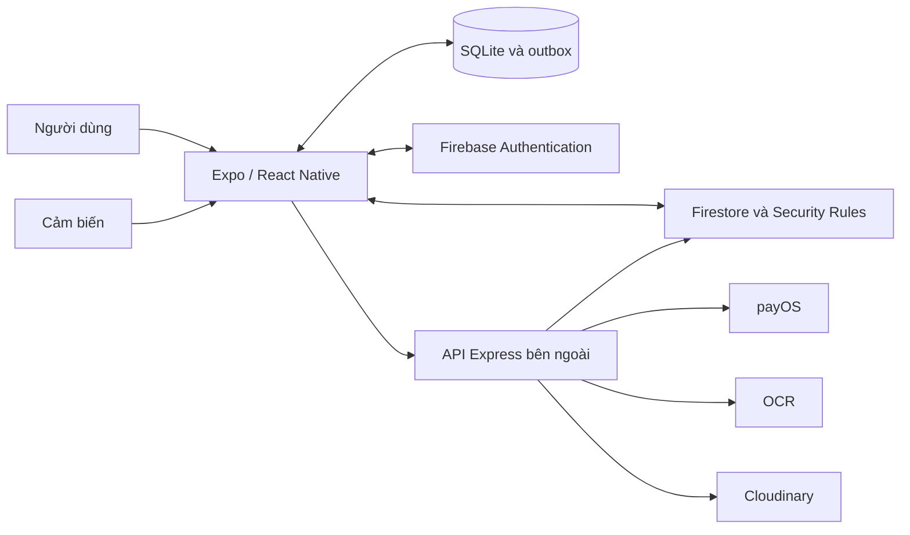

# Kiến trúc DontLift

Ngày đối chiếu: 16/11/2026. Phạm vi: repository mobile. Bản chi tiết nằm trong [software-architecture.md](software-architecture.md) và [ADRs](decisions/).

## Mục lục

- [Thành phần](#thành-phần)
- [Luồng dữ liệu](#luồng-dữ-liệu)
- [Ranh giới tin cậy](#ranh-giới-tin-cậy)
- [Triển khai](#triển-khai)

## Thành phần

Sơ đồ thể hiện các ranh giới tích hợp, không xác nhận dịch vụ đã triển khai. API Express được mô tả trong hợp đồng; mã server đó không nằm trong `functions/` của repository này.

Giao diện ở `src/screens/` và `src/components/`. Entry `src/app/index.tsx` nối màn hình với nghiệp vụ trong `src/features/`. Các đường dẫn này tính từ thư mục ứng dụng.

## Luồng dữ liệu

**Solo:** cảm biến cung cấp trạng thái cho nghiệp vụ phiên. SQLite lưu tổng kết cùng sự kiện outbox trong một giao dịch cục bộ. Worker gửi tổng kết lên `users/{uid}/sessions/{sessionId}` theo [ADR-030](decisions/ADR-030-solo-direct-summary-sync.md). ID ổn định và hash giúp nhận diện gửi lặp. Nội dung khác với bản đã tồn tại trở thành xung đột.

**Nhóm:** Firestore listeners cập nhật phòng và thành viên khi có mạng. Các thao tác được ADR cho phép dùng transaction phía client, có Rules kiểm tra. Thành viên được xác định tại `rooms/{roomId}/members/{uid}`. Không thay bằng mảng người tham gia không giới hạn.

**Hóa đơn:** Host tính và công bố phần chia theo hợp đồng. Thành viên chuyển tiền trực tiếp qua ngân hàng. Trạng thái đánh dấu đã trả không chứng minh giao dịch ngân hàng thành công.

**Premium:** API Express và payOS xử lý đơn mua. Backend cập nhật thời hạn quyền sử dụng. Trang thanh toán redirect về app không tự cấp quyền.

## Ranh giới tin cậy

- Cảm biến thô được xử lý tại thiết bị.
- Firebase Auth quản lý danh tính và phiên đăng nhập.
- Rules kiểm tra quyền và cấu trúc giao dịch, không chứng minh cảm biến đã ghi nhận đúng.
- Tổng kết Solo là lịch sử cá nhân tự báo cáo, không dùng để quyết định điểm nhóm hoặc thanh toán.
- ACK của client không phải bằng chứng backend đã kiểm tra SQLite.
- Rules cho phép Host công bố hóa đơn nhưng không xác minh toàn bộ phép chia hoặc roster.
- Khóa Admin, payOS, OCR và Cloudinary thuộc phía server.

## Triển khai

[ADR-010](decisions/ADR-010-expo-go-firebase-js.md) xác định Firebase JS SDK trong Expo Go. SQLite đảm nhiệm dữ liệu cục bộ và hàng đợi retry. Không dựa vào persistent disk cache của Firestore JS trên React Native.

Runtime yêu cầu project production riêng cho bản release. Expo Go chưa đủ để xác nhận background hoặc khả năng phát hành store. Đối chiếu manifest và ADR mới khi hướng dẫn cũ nhắc SDK hoặc kiến trúc khác.

**Thuật ngữ:** projection là bản dữ liệu phục vụ hiển thị; outbox là hàng đợi sự kiện cần gửi; ADR là bản ghi quyết định kiến trúc.
