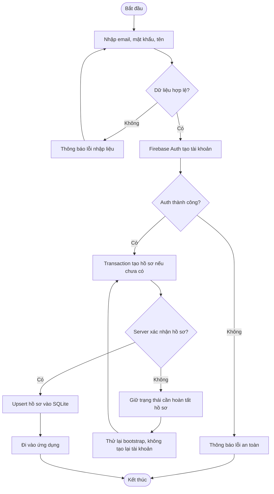

# ACT-01 — Đăng ký và khởi tạo hồ sơ

Auth thành công nhưng hồ sơ chưa hoàn tất là tình huống phục hồi riêng; không ghi đè hồ sơ đã tồn tại.

Nguồn đối chiếu: [decisions/ADR-010-expo-go-firebase-js.md](../../decisions/ADR-010-expo-go-firebase-js.md).
