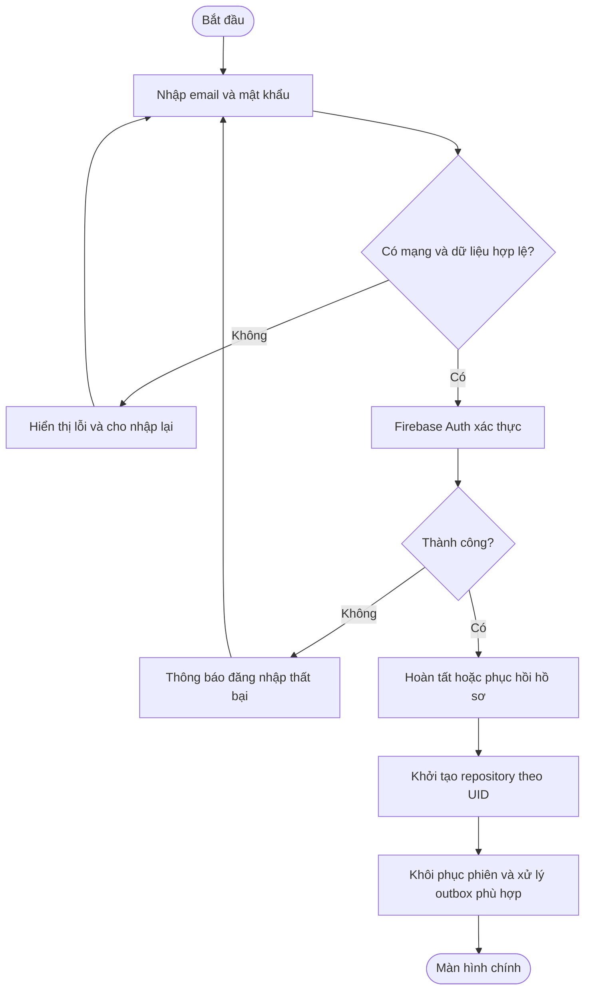

# ACT-02 — Đăng nhập

SDK quản lý persistence và refresh token; ứng dụng không sao chép refresh token vào bảng riêng.

Nguồn đối chiếu: [decisions/ADR-010-expo-go-firebase-js.md](../../decisions/ADR-010-expo-go-firebase-js.md), [architecture.md](../../architecture.md).
