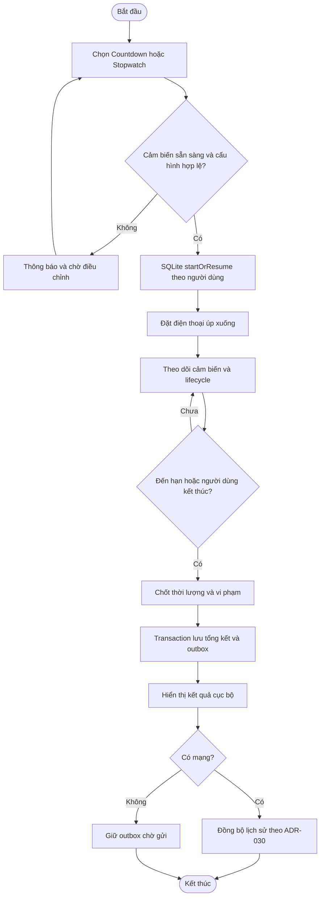

# ACT-03 — Phiên tập trung cá nhân

Countdown hiện kiểm tra 5–720 phút, theo bước 5 phút; Solo có thể hoàn tất khi không có mạng.

Nguồn đối chiếu: [product-requirements.md](../../product-requirements.md), [decisions/ADR-030-solo-direct-summary-sync.md](../../decisions/ADR-030-solo-direct-summary-sync.md).
