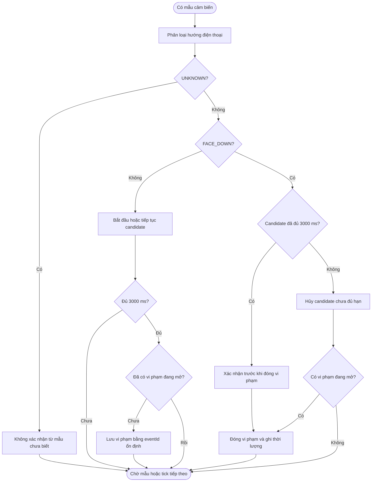

# ACT-04 — Xác nhận vi phạm 3 giây

Đã đọc GracePeriodEngine: mẫu FACE_DOWN đến sau hạn vẫn phải xác nhận vi phạm đủ điều kiện, không được hủy chỉ vì điện thoại vừa úp lại.

Nguồn đối chiếu: [feature-specification.md](../../feature-specification.md), [decisions/ADR-008-platform-session-lifecycle.md](../../decisions/ADR-008-platform-session-lifecycle.md).
