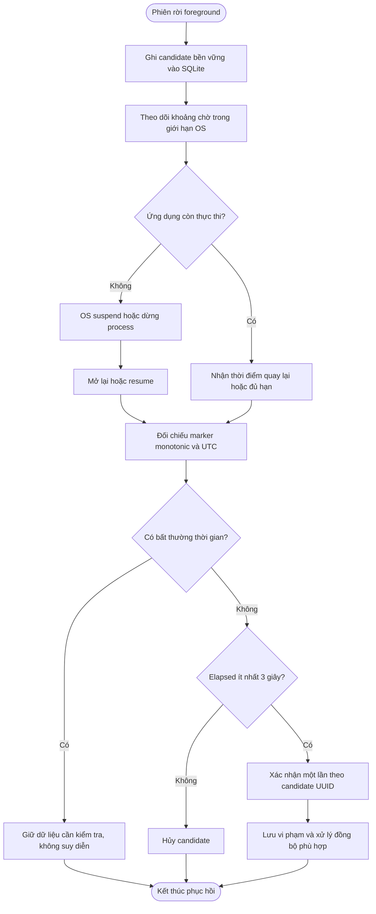

# ACT-05 — Phục hồi lifecycle

Sơ đồ hợp đồng lifecycle ADR-008. Native background adapters là yêu cầu bản dựng phù hợp; không coi Expo Go là bằng chứng đã giám sát nền liên tục.

Nguồn đối chiếu: [decisions/ADR-008-platform-session-lifecycle.md](../../decisions/ADR-008-platform-session-lifecycle.md), [decisions/ADR-010-expo-go-firebase-js.md](../../decisions/ADR-010-expo-go-firebase-js.md).
