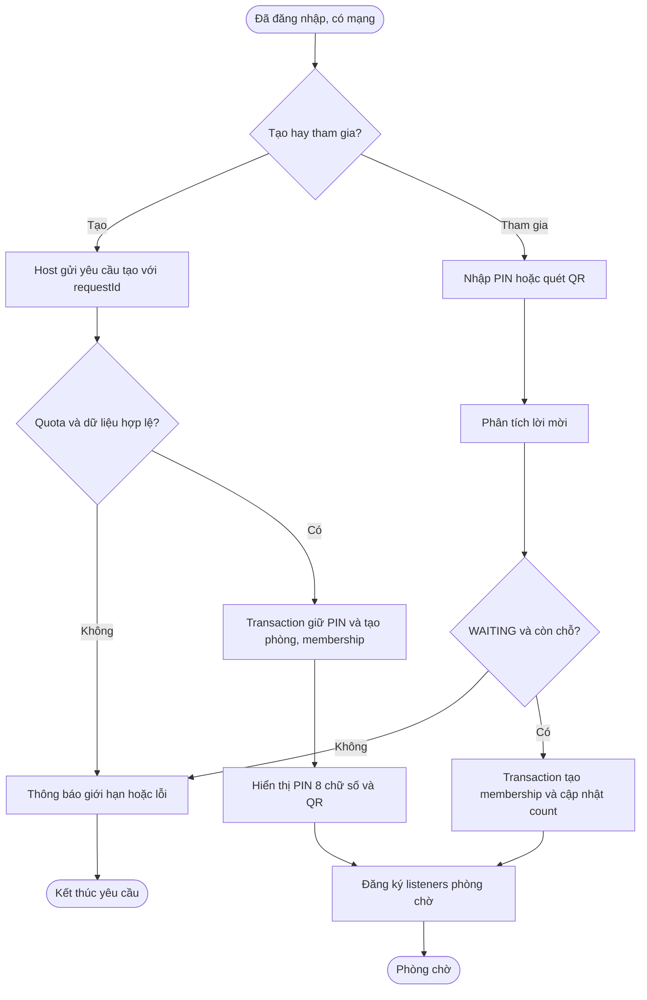

# ACT-06 — Tạo và tham gia phòng

PIN mới 8 chữ số; lời mời 4 chữ số cũ được chấp nhận trong chuyển tiếp. Tạo/join không xếp hàng để phát lại khi offline.

Nguồn đối chiếu: [api-contracts.md](../../api-contracts.md), [decisions/ADR-011-spark-room-creation.md](../../decisions/ADR-011-spark-room-creation.md), [decisions/ADR-012-spark-room-join.md](../../decisions/ADR-012-spark-room-join.md).
