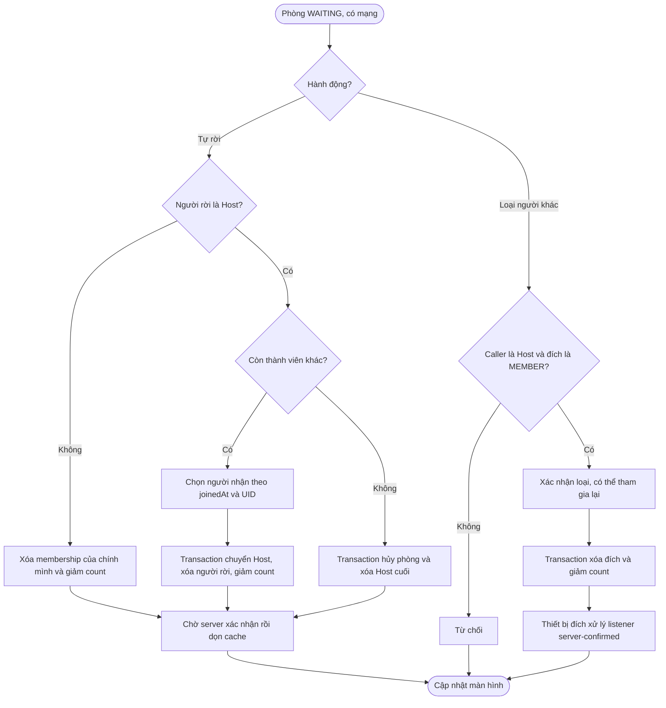

# ACT-07 — Rời hoặc loại thành viên phòng chờ

Quyền loại chỉ ở WAITING. Rules kiểm tra chuyển quyền nguyên tử, không chứng minh thuật toán chọn thành viên sớm nhất.

Nguồn đối chiếu: [decisions/ADR-026-spark-lobby-leave-host-transfer.md](../../decisions/ADR-026-spark-lobby-leave-host-transfer.md), [decisions/ADR-027-spark-lobby-member-removal.md](../../decisions/ADR-027-spark-lobby-member-removal.md).
