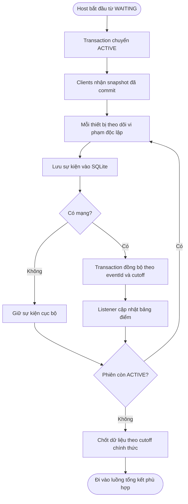

# ACT-08 — Theo dõi phiên nhóm

Điểm chia sẻ lấy từ Firestore; sự kiện đến muộn phải tuân thủ thời gian kết thúc/rời sớm và trạng thái chốt điểm.

Nguồn đối chiếu: [decisions/ADR-013-spark-room-start.md](../../decisions/ADR-013-spark-room-start.md), [decisions/ADR-014-spark-group-violations.md](../../decisions/ADR-014-spark-group-violations.md), [decisions/ADR-015-spark-early-exit.md](../../decisions/ADR-015-spark-early-exit.md).
