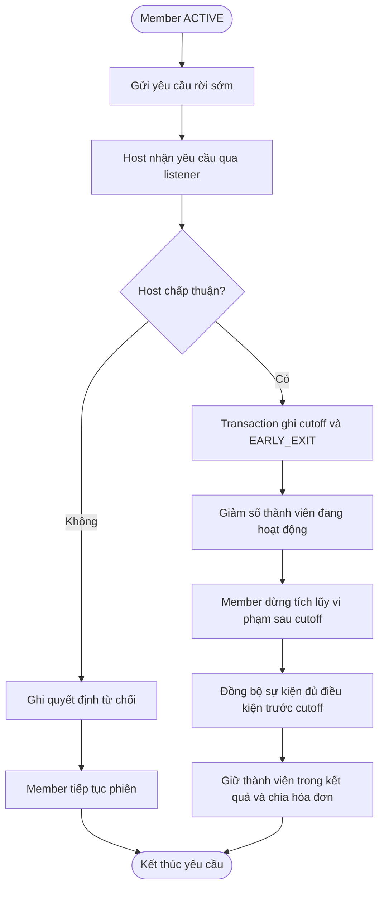

# ACT-09 — Xin rời sớm

Nếu việc rời làm phiếu kết thúc đang mở trở thành nhất trí hợp lệ, giao dịch xử lý trạng thái phòng theo ADR-016.

Nguồn đối chiếu: [decisions/ADR-015-spark-early-exit.md](../../decisions/ADR-015-spark-early-exit.md), [decisions/ADR-016-spark-termination-vote.md](../../decisions/ADR-016-spark-termination-vote.md).
