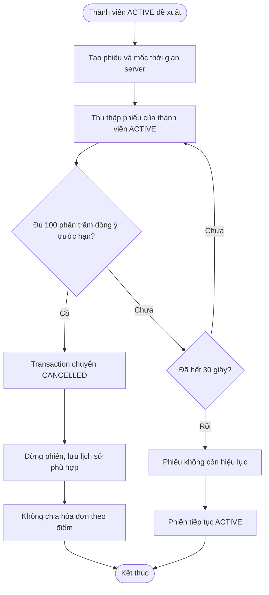

# ACT-10 — Biểu quyết hủy phiên

Hết hạn được kiểm tra theo thời gian server; không cần scheduler xóa phiếu.

Nguồn đối chiếu: [decisions/ADR-016-spark-termination-vote.md](../../decisions/ADR-016-spark-termination-vote.md).
