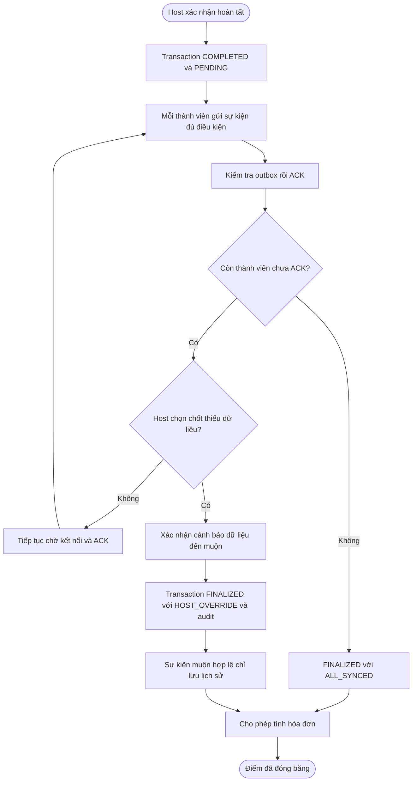

# ACT-11 — Hoàn tất và chốt điểm

ACK là lời xác nhận từ client. Danh sách chưa ACK trong audit là quan sát của Host, không phải roster đã được server xác minh đầy đủ.

Nguồn đối chiếu: [decisions/ADR-017-spark-room-completion.md](../../decisions/ADR-017-spark-room-completion.md), [decisions/ADR-018-spark-host-finalization-override.md](../../decisions/ADR-018-spark-host-finalization-override.md).
