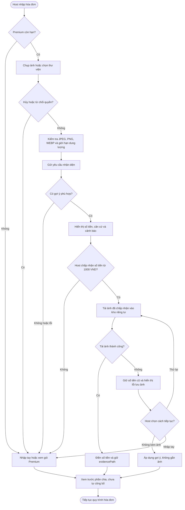

# ACT-12 — Quét hóa đơn và xác nhận

Luồng production qua Express; development có thể gọi PaddleOCR trong LAN. Lỗi và hủy không tự thay số tiền hiện có. Không lưu OCR thô.

Nguồn đối chiếu: [api-contracts.md](../../api-contracts.md).
