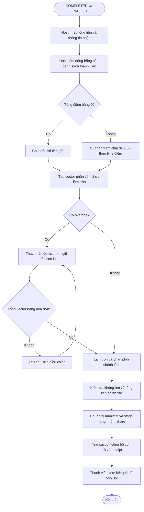

# ACT-13 — Tính, điều chỉnh và công bố hóa đơn

Sơ đồ khái quát pipeline toán học dùng chung. Công bố mặc định và override có hợp đồng ghi phiên bản riêng; override bị khóa khi billPaidCount lớn hơn 0.

Nguồn đối chiếu: [decisions/ADR-021-spark-default-bill.md](../../decisions/ADR-021-spark-default-bill.md), [decisions/ADR-022-spark-bill-overrides.md](../../decisions/ADR-022-spark-bill-overrides.md).
