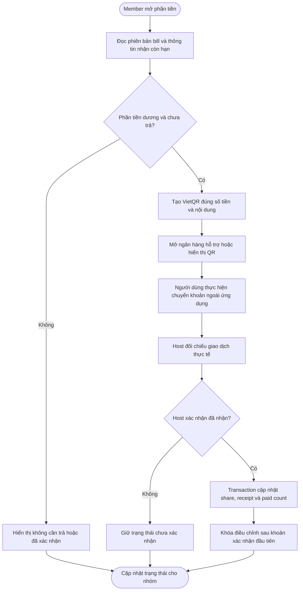

# ACT-14 — VietQR và xác nhận đã trả

Không có webhook ngân hàng cho luồng chia hóa đơn; mở ngân hàng hoặc quét QR không tự đổi trạng thái đã trả.

Nguồn đối chiếu: [decisions/ADR-023-spark-manual-payment-status.md](../../decisions/ADR-023-spark-manual-payment-status.md), [api-contracts.md](../../api-contracts.md).
