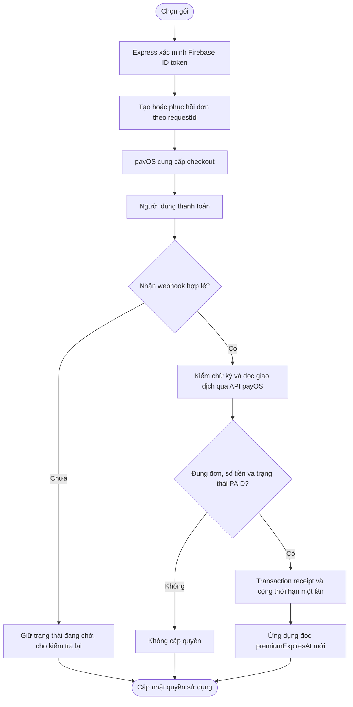

# ACT-15 — Mua và cấp quyền Premium

Redirect chỉ phục vụ điều hướng. Webhook gửi lặp không được gia hạn lặp; mua không tự gia hạn định kỳ.

Nguồn đối chiếu: [decisions/ADR-025-payos-expiring-premium.md](../../decisions/ADR-025-payos-expiring-premium.md), [api-contracts.md](../../api-contracts.md).
