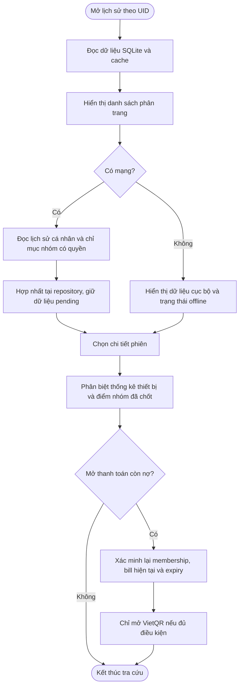

# ACT-16 — Tra cứu lịch sử

Không lưu thông tin ngân hàng hay QR trong lịch sử. Chỉ mục shared room hỗ trợ thành viên tìm lại phiên; tổng kết cục bộ không thay thế điểm nhóm.

Nguồn đối chiếu: [decisions/ADR-030-solo-direct-summary-sync.md](../../decisions/ADR-030-solo-direct-summary-sync.md), [decisions/ADR-024-spark-group-history.md](../../decisions/ADR-024-spark-group-history.md), [decisions/ADR-028-shared-group-history-index.md](../../decisions/ADR-028-shared-group-history-index.md).
