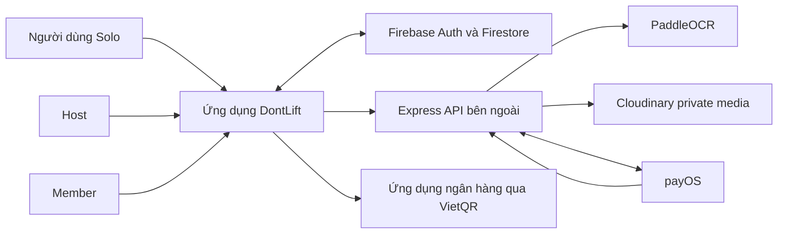

# ARC-01 — Ngữ cảnh hệ thống

Các mũi tên thể hiện ranh giới tương tác. DontLift không giữ tiền chuyển giữa thành viên; payOS chỉ phục vụ mua Premium.

Nguồn đối chiếu: [architecture.md](../../architecture.md), [api-contracts.md](../../api-contracts.md).
