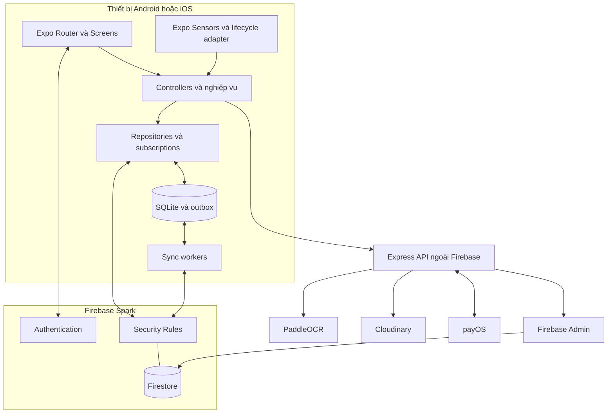

# ARC-02 — Thành phần và quyền sở hữu dữ liệu

Admin bypass Rules nên Express phải tự xác minh quyền. Không biểu diễn Cloud Functions hoặc native Firestore disk cache như thành phần runtime bắt buộc hiện tại.

Nguồn đối chiếu: [architecture.md](../../architecture.md), [decisions/ADR-010-expo-go-firebase-js.md](../../decisions/ADR-010-expo-go-firebase-js.md), [api-contracts.md](../../api-contracts.md).
