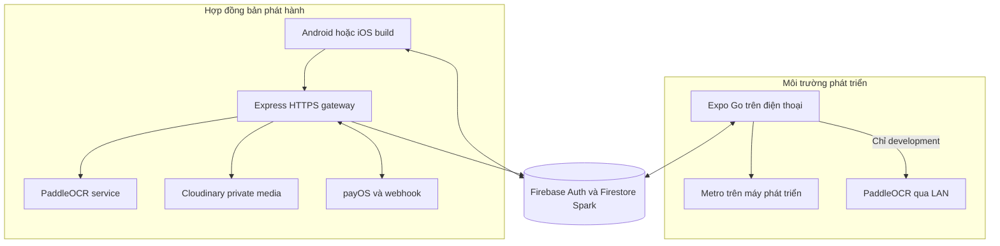

# ARC-03 — Development và production

Sơ đồ mô tả môi trường và hợp đồng triển khai, không xác nhận dịch vụ đã deploy. OCR trực tiếp bị vô hiệu trong release; kiểm chứng background cần thiết bị và bản dựng phù hợp.

Nguồn đối chiếu: [decisions/ADR-010-expo-go-firebase-js.md](../../decisions/ADR-010-expo-go-firebase-js.md), [api-contracts.md](../../api-contracts.md), [decisions/ADR-025-payos-expiring-premium.md](../../decisions/ADR-025-payos-expiring-premium.md).
