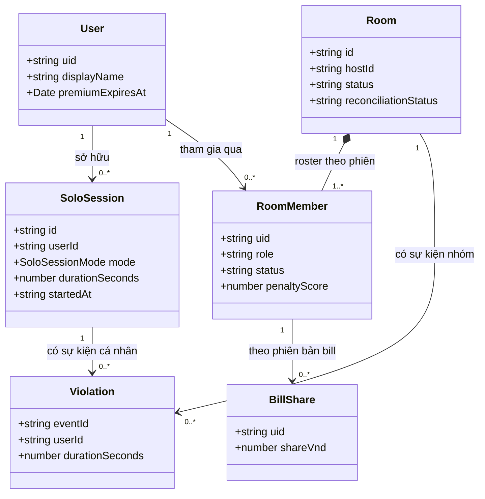

# CLS-01 — Mô hình miền tổng quan

Mô hình khái niệm, không khẳng định các entity đều là class có constructor. Violation thuộc ngữ cảnh Solo hoặc nhóm; không bắt buộc thuộc cả hai.

Nguồn đối chiếu: [feature-specification.md](../../feature-specification.md), [api-contracts.md](../../api-contracts.md).
