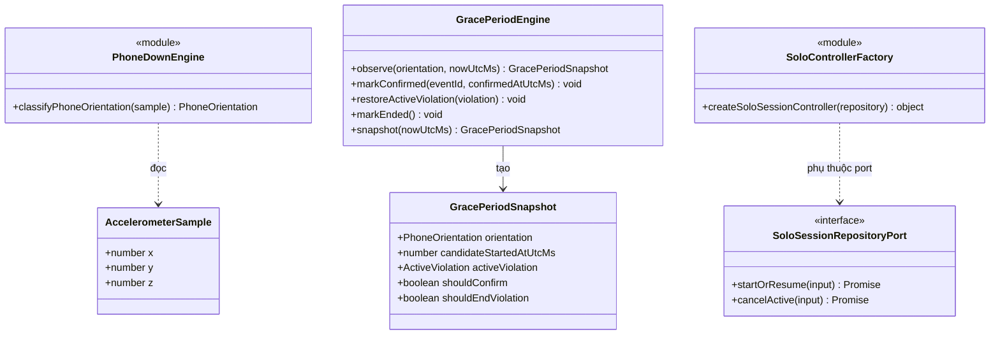

# CLS-02 — Hợp đồng Solo và cảm biến

Tên module hiển thị là nhóm chức năng để trình bày; classifyPhoneOrientation và createSoloSessionController là hàm thực tế, không phải class triển khai.

Nguồn đối chiếu: [feature-specification.md](../../feature-specification.md), [decisions/ADR-008-platform-session-lifecycle.md](../../decisions/ADR-008-platform-session-lifecycle.md).
