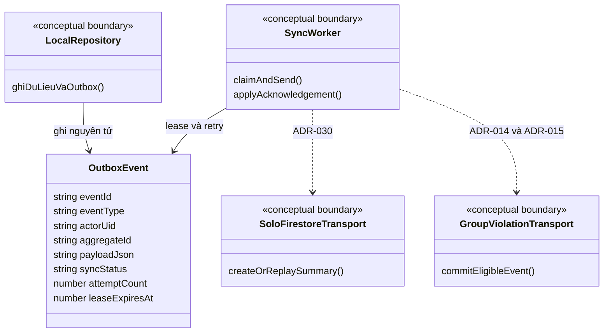

# CLS-03 — Cấu trúc đồng bộ dữ liệu

Sơ đồ trách nhiệm khái niệm tương ứng các module sync-worker, outbox-repository, firestore-solo-sync-port và group-violation-repository. Tên phương thức minh họa trách nhiệm, không phải API xuất chính xác.

Nguồn đối chiếu: [architecture.md](../../architecture.md), [decisions/ADR-030-solo-direct-summary-sync.md](../../decisions/ADR-030-solo-direct-summary-sync.md), [decisions/ADR-014-spark-group-violations.md](../../decisions/ADR-014-spark-group-violations.md).
