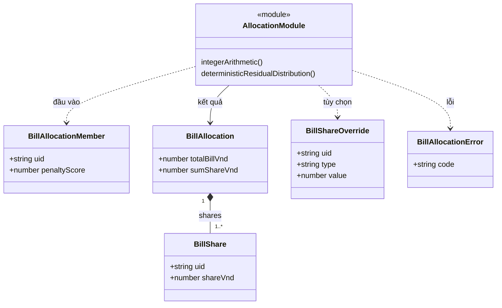

# CLS-04 — Kiểu dữ liệu tính hóa đơn

Các type BillAllocationMember, BillShare, BillAllocation, BillShareOverride và BillAllocationError có trong bill-allocation.ts. Các thao tác trên AllocationModule mô tả thuật toán, không giả lập tên hàm xuất.

Nguồn đối chiếu: [decisions/ADR-021-spark-default-bill.md](../../decisions/ADR-021-spark-default-bill.md), [decisions/ADR-022-spark-bill-overrides.md](../../decisions/ADR-022-spark-bill-overrides.md).
