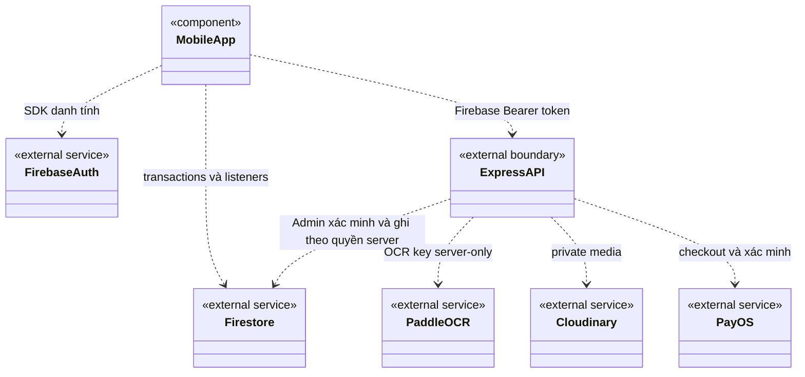

# CLS-05 — Ranh giới tích hợp dịch vụ

Sơ đồ phụ thuộc thành phần dưới ký pháp lớp, không phải mô hình kế thừa. Mã Express/PaddleOCR nằm ngoài repository mobile.

Nguồn đối chiếu: [architecture.md](../../architecture.md), [api-contracts.md](../../api-contracts.md), [decisions/ADR-025-payos-expiring-premium.md](../../decisions/ADR-025-payos-expiring-premium.md).
