# CLS-06 — Sơ đồ lớp tổng hợp toàn hệ thống

Một sơ đồ tổng hợp các kiểu dữ liệu, lớp và module chính trong toàn hệ thống, gom theo sáu phạm vi. Sơ đồ kết nối tài khoản, phiên cá nhân, cảm biến và vi phạm, phòng nhóm, hóa đơn, đồng bộ và lịch sử, cùng premium.

[Mở SVG để phóng to](cls-06-toan-bo-he-thong.svg) · [PNG để chèn báo cáo](cls-06-toan-bo-he-thong.png)

### Quy ước và phạm vi

- `interface` và `type` giữ tên hợp đồng TypeScript; không phải class có constructor. `GracePeriodEngine` là class triển khai thực tế, có thuộc tính riêng và phương thức công khai.
- `PhoneDownModule` gom hàm `classifyPhoneOrientation`; `BillAllocationModule` gom các hàm tính phần chia. Hai tên module chỉ phục vụ cách trình bày UML, không phải class có sẵn trong mã nguồn.
- Đường liền là quan hệ dữ liệu theo ID hoặc cấu trúc chứa; nét đứt là sử dụng dữ liệu/trao đổi kết quả ở mức thiết kế. Không suy ra rằng mỗi cạnh đều là một import trực tiếp hoặc một khóa ngoại vật lý.
- RoomLobbySnapshot chứa các snapshot thành viên, không sở hữu vòng đời tài khoản. Host/Member nằm ở thuộc tính `role`, không tạo các lớp tài khoản kế thừa giả định.
- Thuộc tính chỉ chọn phần quan trọng. Kiểu `number`/`string` có thể optional hoặc nullable theo source; ví dụ expiry, cutoff, paidAt và thời điểm vi phạm đang mở. Các Promise trong sơ đồ đã rút gọn generic để dễ đọc. `cancelActive` là thao tác tùy chọn của port.
- `BillShare` trên sơ đồ là kiểu ở bill-repository (gồm trạng thái trả). `BillAllocation.shares` là các cặp uid/shareVnd từ bộ tính, chưa có thông tin thanh toán. Đây là hai hợp đồng có cùng tên trong hai module, không phải dữ liệu đã trả do thuật toán tự tạo.
- ReceiptScanResult chỉ gợi ý; Host xác nhận rồi repository mới dùng dữ liệu để lập hóa đơn. PremiumOrder là phản hồi theo chủ tài khoản đã xác thực; không thêm ownerUid vào type khi source không khai báo.
- Sơ đồ tổng hợp các thành phần chính phục vụ báo cáo; không liệt kê toàn bộ lỗi, props giao diện hoặc mọi type nội bộ. Các sơ đồ lớp module cũ vẫn giữ để xem chi tiết.

### Mã nguồn đối chiếu

| Phạm vi | Nguồn |
|---|---|
| Tài khoản và ports | [auth-controller.ts](../../../src/features/auth/auth-controller.ts) |
| Phiên và tổng kết Solo | [session-controller.ts](../../../src/features/solo/session-controller.ts), [summary-service.ts](../../../src/features/solo/summary-service.ts) |
| Cảm biến và vi phạm | [phone-down-engine.ts](../../../src/features/sensors/phone-down-engine.ts), [grace-period-engine.ts](../../../src/features/solo/grace-period-engine.ts), [violation-repository.ts](../../../src/features/solo/violation-repository.ts) |
| Phòng và thành viên | [room-listener.ts](../../../src/features/rooms/room-listener.ts) |
| Rời sớm và biểu quyết | [early-exit-repository.ts](../../../src/features/rooms/early-exit-repository.ts), [termination-vote-repository.ts](../../../src/features/rooms/termination-vote-repository.ts) |
| Hóa đơn | [bill-repository.ts](../../../src/features/settlement/bill-repository.ts), [bill-allocation.ts](../../../src/features/settlement/bill-allocation.ts), [settlement-details-repository.ts](../../../src/features/settlement/settlement-details-repository.ts) |
| OCR | [receipt-scan-api.ts](../../../src/features/settlement/receipt-scan-api.ts) |
| Đồng bộ và lịch sử | [sync-worker.ts](../../../src/features/sync/sync-worker.ts), [group-history-model.ts](../../../src/features/history/group-history-model.ts) |
| Premium | [premium-api.ts](../../../src/features/premium/premium-api.ts) |

SVG và PNG được xuất từ cùng khối Mermaid bên dưới bằng `tools/render_check.mjs`. Khi đổi source, chạy lại build rồi render để cập nhật ảnh. Sơ đồ không xác nhận các dịch vụ bên ngoài đã triển khai thành công.

```mermaid
classDiagram
    direction TB
    namespace TaiKhoan {
        class RegistrationProfile {
            <<interface>>
            +string uid
            +string email
            +string displayName
            +number premiumExpiresAtUtcMs
            +string avatarUri
        }
        class RegistrationAuthPort {
            <<interface>>
            +getCurrentUser() RegistrationUser
            +createAccount(email, password) Promise
            +setDisplayName(user, displayName) Promise
            +completeProfile(request) Promise
        }
        class RegistrationProfilePort {
            <<interface>>
            +upsert(profile) Promise
        }
    }
    namespace TapTrungVaCamBien {
        class SoloSession {
            <<type>>
            +string id
            +string userId
            +SoloSessionMode mode
            +number durationSeconds
            +string startedAt
        }
        class SoloSessionSummary {
            <<type>>
            +string sessionId
            +string userId
            +number durationSeconds
            +number liftCount
            +number violationDurationSeconds
            +number penaltyScore
            +string completedAt
        }
        class AccelerometerSample {
            <<type>>
            +number x
            +number y
            +number z
        }
        class GracePeriodEngine {
            -PhoneOrientation orientation
            -number candidateStartedAtUtcMs
            -ActiveViolation activeViolation
            +observe(orientation, nowUtcMs) GracePeriodSnapshot
            +snapshot(nowUtcMs) GracePeriodSnapshot
            +markConfirmed(eventId, confirmedAtUtcMs) void
            +restoreActiveViolation(violation) void
            +markEnded() void
        }
        class GracePeriodSnapshot {
            <<type>>
            +PhoneOrientation orientation
            +number candidateStartedAtUtcMs
            +number graceRemainingMs
            +ActiveViolation activeViolation
            +boolean shouldConfirm
            +boolean shouldEndViolation
        }
        class ActiveViolation {
            <<type>>
            +string eventId
            +number startedAtUtcMs
            +number confirmedAtUtcMs
        }
        class ViolationRecord {
            <<type>>
            +string eventId
            +string sessionId
            +number startedAtUtcMs
            +number endedAtUtcMs
            +number durationSeconds
        }
        class SoloSessionRepositoryPort {
            <<type>>
            +startOrResume(input) Promise
            +cancelActive(input) Promise
        }
        class PhoneDownModule {
            <<module>>
            +classifyPhoneOrientation(sample) PhoneOrientation
        }
    }
    namespace PhongNhom {
        class RoomLobbySnapshot {
            <<type>>
            +string roomId
            +string hostUid
            +string status
            +string pin
            +number participantCount
            +number activeMemberCount
            +string reconciliationStatus
            +string finalizationReason
            +RoomLobbyMember[] members
        }
        class RoomLobbyMember {
            <<type>>
            +string uid
            +string displayName
            +string role
            +string status
            +number liftCount
            +number violationDurationSeconds
            +number penaltyScore
            +number earlyExitAtUtcMs
        }
        class EarlyExitRequest {
            <<type>>
            +string requestId
            +string memberUid
            +string status
            +string decision
            +number cutoffUtcMs
        }
        class TerminationVote {
            <<type>>
            +string roomId
            +string voteId
            +number openedAtUtcMs
            +number eligibleVoterCount
            +number yesVoteCount
            +string status
        }
        class TerminationBallot {
            <<type>>
            +string voteId
            +string requestId
            +TerminationChoice choice
        }
    }
    namespace HoaDon {
        class PublishedBill {
            <<type>>
            +string requestId
            +string roomId
            +number totalBillVnd
            +number sumShareVnd
            +number billRevision
            +number billPaidCount
            +string receiptEvidencePath
            +BillShare[] shares
        }
        class BillShare {
            <<type>>
            +string uid
            +number shareVnd
            +string paymentStatus
            +number paidAtUtcMs
            +string paidBy
        }
        class BillShareOverride {
            <<type>>
            +string uid
            +string type
            +number value
        }
        class SettlementDetails {
            <<type>>
            +string roomId
            +string bankId
            +string accountNumber
            +string accountName
            +number expiresAtUtcMs
        }
        class ReceiptScanResult {
            <<type>>
            +string status
            +number amount
            +number suggested_amount
            +string currency
            +boolean needs_confirmation
            +string[] warnings
        }
        class BillAllocationModule {
            <<module>>
            +calculateDefaultBillShares(totalBillVnd, members) BillAllocation
            +calculateBillSharesWithOverrides(totalBillVnd, members, overrides) BillAllocation
        }
        class BillAllocation {
            <<type>>
            +number totalBillVnd
            +number sumShareVnd
            +object[] shares
        }
    }
    namespace DongBoVaLichSu {
        class SoloSyncEvent {
            <<type>>
            +string eventId
            +string sessionId
            +string aggregateId
            +number occurredAtUtcMs
            +number attemptCount
            +object payload
        }
        class SoloSyncOutcome {
            <<type>>
            +string eventId
            +string status
            +boolean retryable
            +string errorCode
        }
        class SyncWorkerTransport {
            <<type>>
            +sendBatch(events) Promise
        }
        class GroupLocalSummary {
            <<type>>
            +string eventId
            +string actorUid
            +string roomId
            +string status
            +number completedAtUtcMs
            +number penaltyScore
        }
        class GroupHistoryEntry {
            <<type>>
            +GroupLocalSummary summary
            +string syncStatus
            +string source
        }
    }
    namespace Premium {
        class PremiumPackage {
            <<type>>
            +string id
            +number amountVnd
            +number paidMonths
            +number grantedMonths
        }
        class PremiumOrder {
            <<type>>
            +string requestId
            +number orderCode
            +string packageId
            +number amountVnd
            +string status
            +string checkoutUrl
            +number premiumExpiresAtUtcMs
        }
    }
    RegistrationAuthPort ..> RegistrationProfile : profile trong response
    RegistrationProfilePort ..> RegistrationProfile : upsert
    RegistrationProfile "1" --> "0..*" SoloSession : userId
    RegistrationProfile "1" --> "0..*" RoomLobbyMember : uid theo phong
    RegistrationProfile "1" --> "0..*" GroupLocalSummary : actorUid
    SoloSession "1" --> "0..1" SoloSessionSummary : tong ket
    SoloSessionRepositoryPort ..> SoloSession : startOrResume
    PhoneDownModule ..> AccelerometerSample : dau vao
    PhoneDownModule ..> GracePeriodEngine : orientation dau vao observe
    GracePeriodEngine --> GracePeriodSnapshot : tra ve
    GracePeriodEngine --> "0..1" ActiveViolation : giu trang thai
    GracePeriodSnapshot --> "0..1" ActiveViolation : snapshot
    SoloSession "1" --> "0..*" ViolationRecord : sessionId
    ActiveViolation ..> ViolationRecord : luu vi pham
    SoloSessionSummary ..> ViolationRecord : tong hop nhat ky
    RoomLobbySnapshot "1" o-- "1..*" RoomLobbyMember : members
    RoomLobbySnapshot "1" --> "0..*" EarlyExitRequest : ngu canh phong
    RoomLobbyMember "1" --> "0..*" EarlyExitRequest : memberUid
    RoomLobbySnapshot "1" --> "0..*" TerminationVote : roomId
    TerminationVote "1" --> "0..*" TerminationBallot : voteId
    RoomLobbySnapshot "1" --> "0..1" PublishedBill : ban hien hanh
    PublishedBill "1" *-- "1..*" BillShare : shares
    RoomLobbyMember "1" --> "0..1" BillShare : uid trong bill hien hanh
    PublishedBill --> "0..1" SettlementDetails : ngu canh roomId
    BillShareOverride ..> BillShare : thay raw allocation theo uid
    BillAllocationModule ..> BillShareOverride : tuy chon
    BillAllocationModule ..> RoomLobbyMember : lay uid va penaltyScore
    BillAllocationModule ..> PublishedBill : ket qua phan chia de cong bo
    BillAllocationModule --> BillAllocation : tra ve
    BillAllocation ..> PublishedBill : du lieu phan chia cho repository
    ReceiptScanResult ..> PublishedBill : Host xac nhan tong tien
    SoloSessionSummary ..> SoloSyncEvent : tao payload
    SyncWorkerTransport ..> SoloSyncEvent : serialize va gui
    SyncWorkerTransport --> SoloSyncOutcome : outcomes
    RoomLobbySnapshot "1" --> "0..*" GroupLocalSummary : roomId theo actor
    GroupHistoryEntry "1" *-- "1" GroupLocalSummary : summary
    PremiumOrder "0..*" --> "1" PremiumPackage : packageId
    PremiumOrder ..> RegistrationProfile : server cap nhat expiry
```

Nguồn đối chiếu: [architecture.md](../../architecture.md), [api-contracts.md](../../api-contracts.md), [feature-specification.md](../../feature-specification.md), [decisions/ADR-030-solo-direct-summary-sync.md](../../decisions/ADR-030-solo-direct-summary-sync.md), [decisions/ADR-025-payos-expiring-premium.md](../../decisions/ADR-025-payos-expiring-premium.md).
