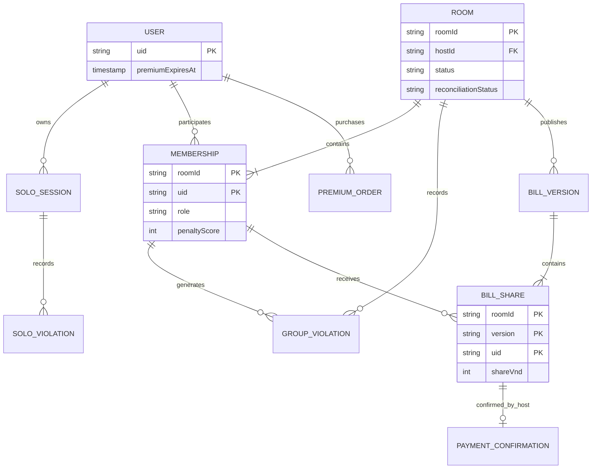

# ERD-01 — Thực thể nghiệp vụ

Mô hình logic phục vụ báo cáo. BILL_VERSION và PAYMENT_CONFIRMATION là khái niệm nghiệp vụ; cách lưu vật lý là manifest, shares và command receipts, không mặc định có bảng SQL cùng tên.

Nguồn đối chiếu: [feature-specification.md](../../feature-specification.md), [api-contracts.md](../../api-contracts.md).
