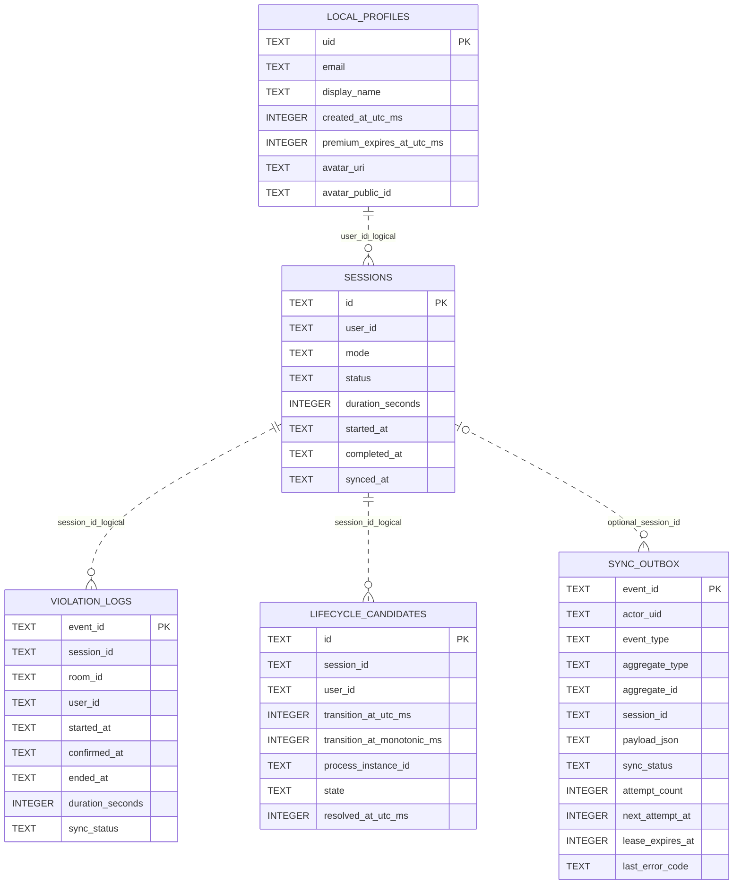

# ERD-02 — SQLite: phiên và đồng bộ

Đối chiếu migrations.ts; chỉ liệt kê các cột chính để dễ đọc. Nét đứt là liên kết logic theo ID, không khẳng định có FOREIGN KEY. Một phiên GROUP có ngữ cảnh phòng; outbox có thể không gắn session_id.

Nguồn đối chiếu: [architecture.md](../../architecture.md), [decisions/ADR-030-solo-direct-summary-sync.md](../../decisions/ADR-030-solo-direct-summary-sync.md).
