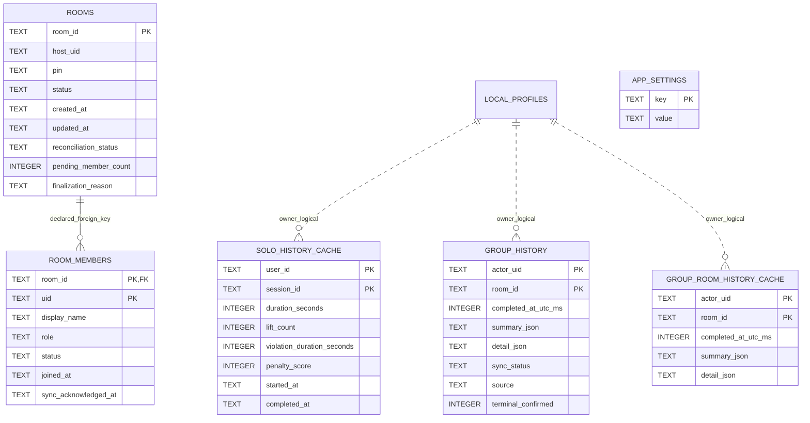

# ERD-03 — SQLite: phòng và lịch sử

Chỉ rooms → room_members được vẽ như FK khai báo. History là projection theo owner; không buộc tồn tại một room cache cục bộ tương ứng. APP_SETTINGS độc lập.

Nguồn đối chiếu: [architecture.md](../../architecture.md), [decisions/ADR-024-spark-group-history.md](../../decisions/ADR-024-spark-group-history.md), [decisions/ADR-028-shared-group-history-index.md](../../decisions/ADR-028-shared-group-history-index.md).
