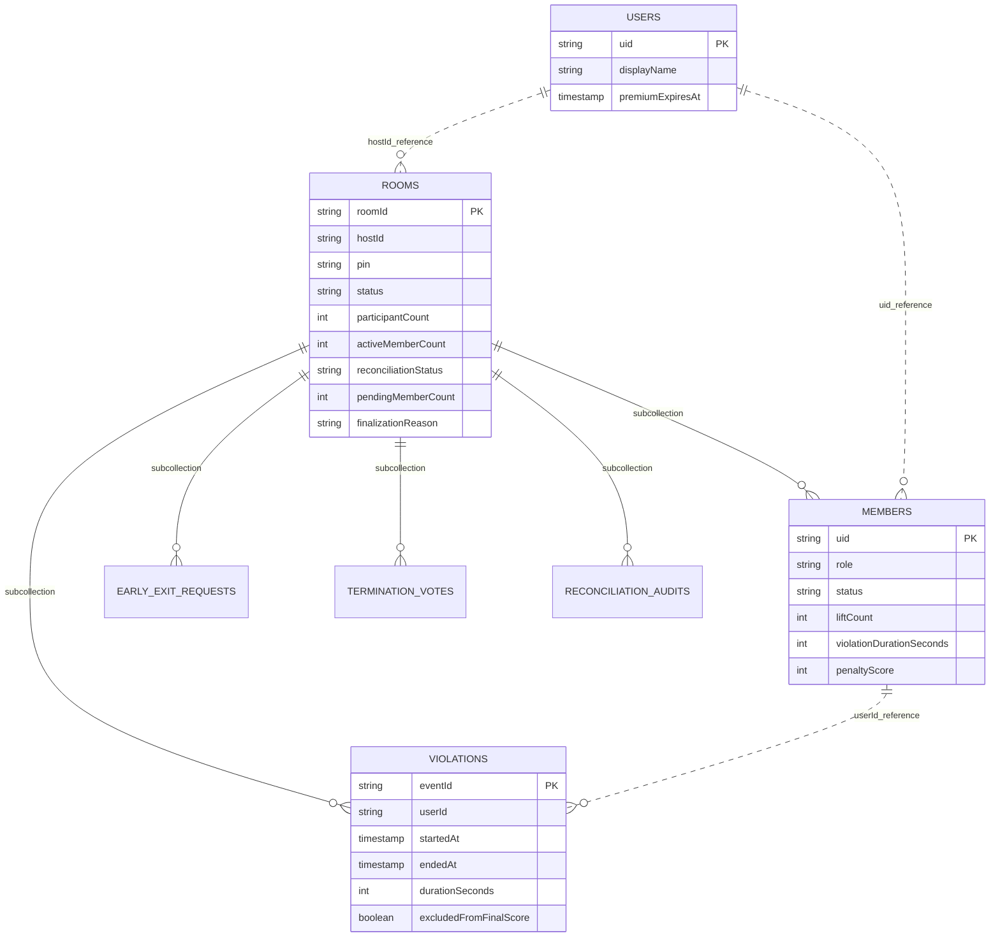

# ERD-04 — Firestore: phòng và thành viên

ERD thích nghi cho NoSQL: PK là document ID trong collection cha, không phải khóa SQL toàn cục. Nét liền là chứa subcollection; nét đứt là tham chiếu logic. Không dùng participantIds làm nguồn membership.

Nguồn đối chiếu: [api-contracts.md](../../api-contracts.md), [architecture.md](../../architecture.md).
