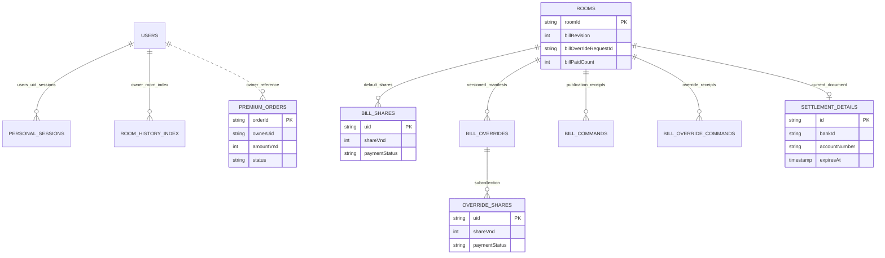

# ERD-05 — Firestore: hóa đơn, lịch sử và Premium

Các nhãn PERSONAL_SESSIONS và ROOM_HISTORY_INDEX đại diện đường dẫn cá nhân, không phải collection gốc. Chi tiết path/field theo api-contracts; chỉ trích các trường chính. Premium orders do backend quản lý; ảnh Cloudinary không nằm trong Firestore.

Nguồn đối chiếu: [api-contracts.md](../../api-contracts.md), [decisions/ADR-025-payos-expiring-premium.md](../../decisions/ADR-025-payos-expiring-premium.md), [decisions/ADR-030-solo-direct-summary-sync.md](../../decisions/ADR-030-solo-direct-summary-sync.md).
