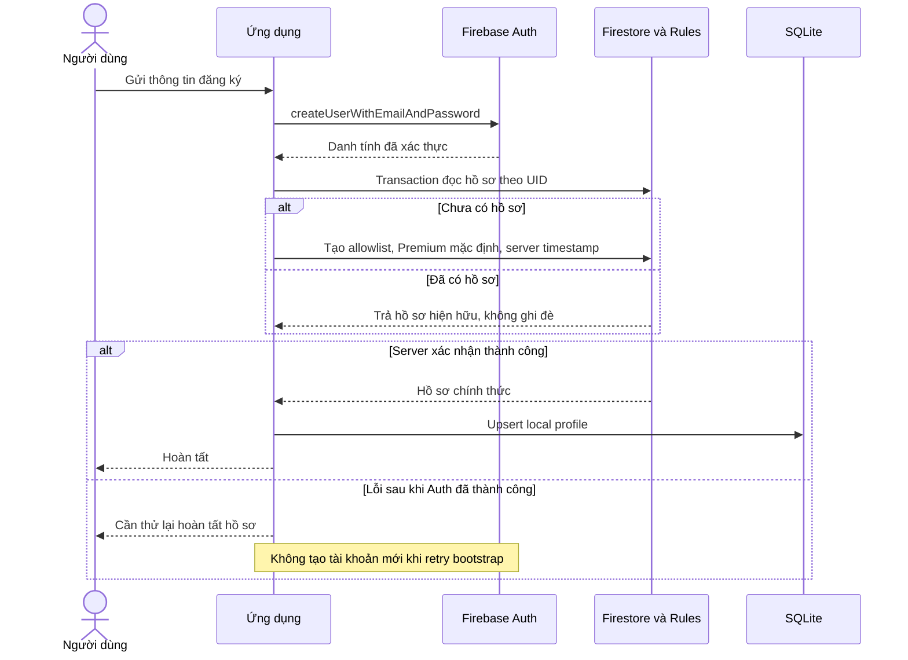

# SEQ-01 — Đăng ký và phục hồi hồ sơ

Theo runtime Firebase JS SDK, không dùng callable bootstrap cũ.

Nguồn đối chiếu: [decisions/ADR-010-expo-go-firebase-js.md](../../decisions/ADR-010-expo-go-firebase-js.md).
