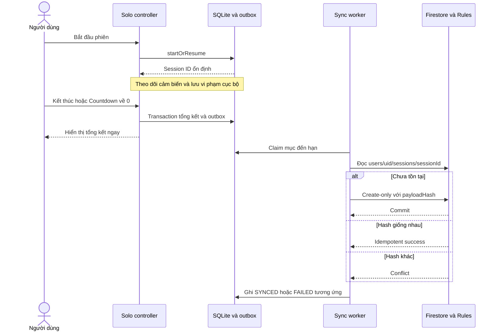

# SEQ-02 — Hoàn tất và đồng bộ Solo

Tổng kết cá nhân tự báo cáo; không dùng để cấp quyền, chia tiền hay sửa điểm nhóm.

Nguồn đối chiếu: [decisions/ADR-030-solo-direct-summary-sync.md](../../decisions/ADR-030-solo-direct-summary-sync.md).
