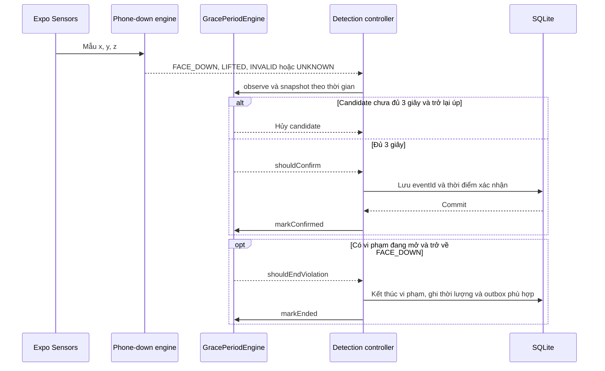

# SEQ-03 — Cảm biến và vi phạm

Dữ liệu cảm biến thô không rời thiết bị; snapshot trạng thái chưa biết không tự chứng minh vi phạm.

Nguồn đối chiếu: [feature-specification.md](../../feature-specification.md), [decisions/ADR-008-platform-session-lifecycle.md](../../decisions/ADR-008-platform-session-lifecycle.md).
