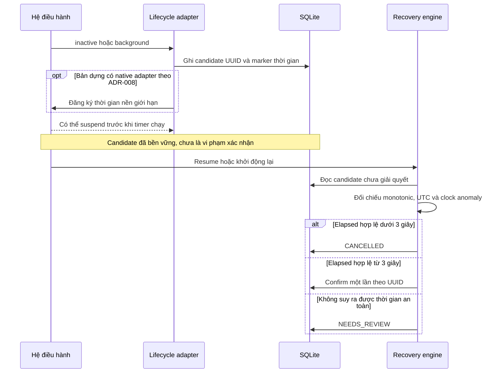

# SEQ-04 — Background và phục hồi

Đây là hợp đồng lifecycle; không khẳng định Expo Go thực thi native background task hoặc WorkManager.

Nguồn đối chiếu: [decisions/ADR-008-platform-session-lifecycle.md](../../decisions/ADR-008-platform-session-lifecycle.md), [decisions/ADR-010-expo-go-firebase-js.md](../../decisions/ADR-010-expo-go-firebase-js.md).
