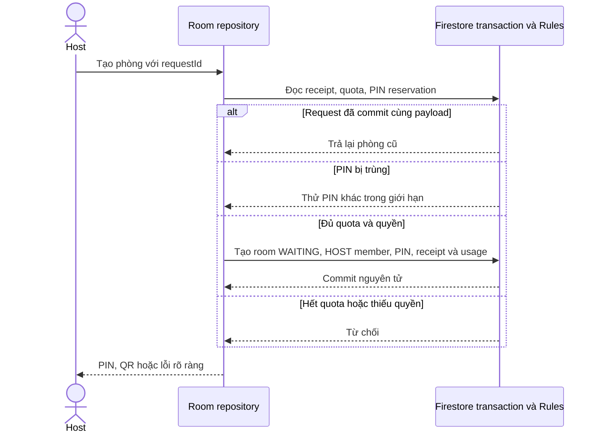

# SEQ-05 — Tạo phòng trên Spark

Không gọi createRoom Cloud Function trong luồng Spark hiện tại.

Nguồn đối chiếu: [decisions/ADR-011-spark-room-creation.md](../../decisions/ADR-011-spark-room-creation.md), [api-contracts.md](../../api-contracts.md).
