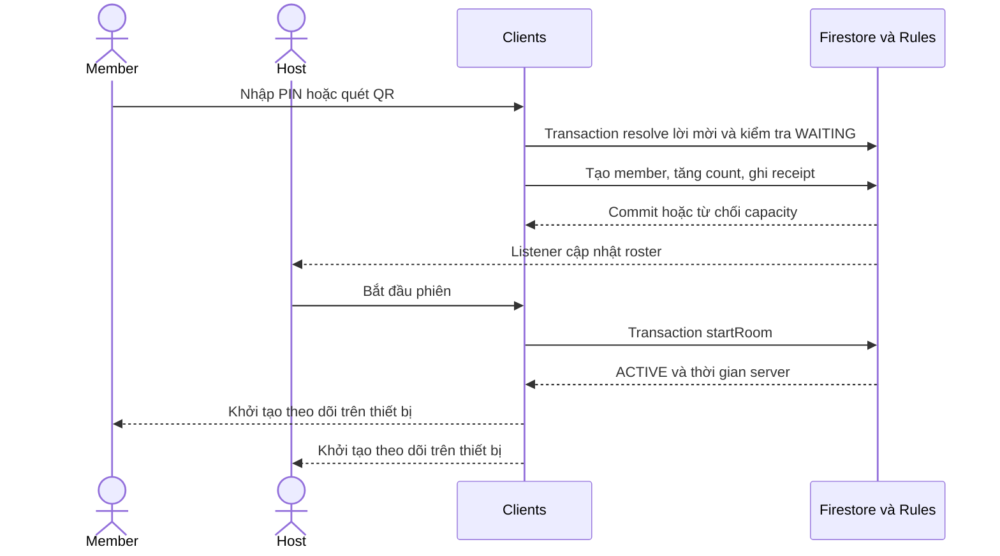

# SEQ-06 — Tham gia và bắt đầu nhóm

Membership là subcollection members theo UID. Retry cùng request không tạo thêm thành viên.

Nguồn đối chiếu: [decisions/ADR-012-spark-room-join.md](../../decisions/ADR-012-spark-room-join.md), [decisions/ADR-013-spark-room-start.md](../../decisions/ADR-013-spark-room-start.md).
