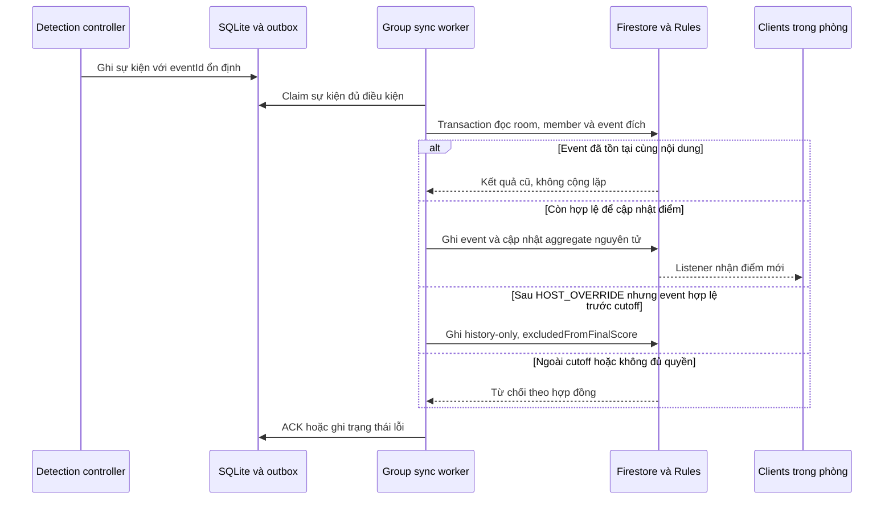

# SEQ-07 — Đồng bộ vi phạm nhóm

Rules kiểm tra giao dịch và dữ liệu, không chứng minh cảm biến thực sự quan sát được sự kiện.

Nguồn đối chiếu: [decisions/ADR-014-spark-group-violations.md](../../decisions/ADR-014-spark-group-violations.md), [decisions/ADR-015-spark-early-exit.md](../../decisions/ADR-015-spark-early-exit.md), [decisions/ADR-018-spark-host-finalization-override.md](../../decisions/ADR-018-spark-host-finalization-override.md).
