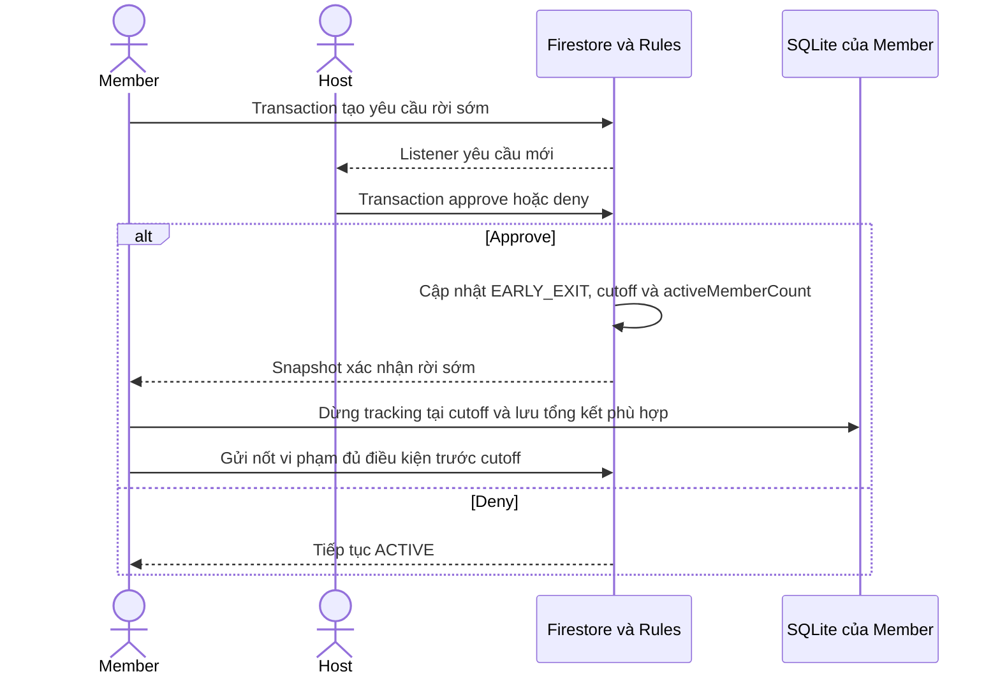

# SEQ-08 — Yêu cầu và duyệt rời sớm

Thành viên rời sớm vẫn ở roster phục vụ tổng kết và chia tiền.

Nguồn đối chiếu: [decisions/ADR-015-spark-early-exit.md](../../decisions/ADR-015-spark-early-exit.md).
