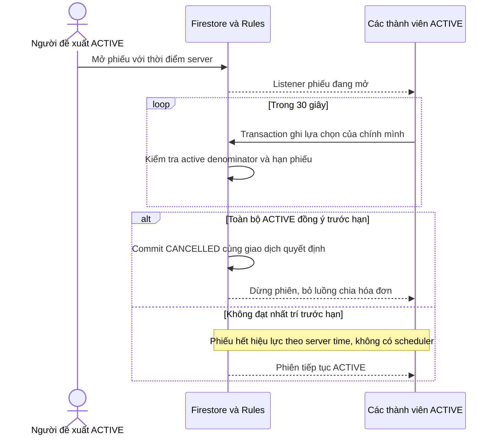

# SEQ-09 — Biểu quyết kết thúc

Các nhánh là kết quả giao dịch do client khởi tạo và Rules kiểm tra; Firestore không tự chạy timer kết thúc phiếu.

Nguồn đối chiếu: [decisions/ADR-016-spark-termination-vote.md](../../decisions/ADR-016-spark-termination-vote.md).
