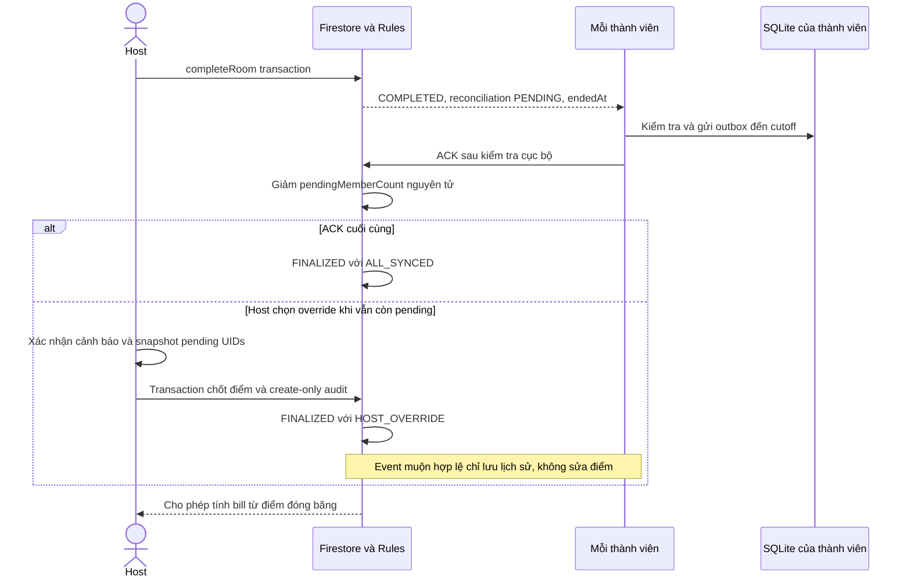

# SEQ-10 — Hoàn tất, ACK và Host override

Không có timeout tự chốt ALL_SYNCED. Rules không đọc SQLite và không chứng minh danh sách pending của Host đầy đủ.

Nguồn đối chiếu: [decisions/ADR-017-spark-room-completion.md](../../decisions/ADR-017-spark-room-completion.md), [decisions/ADR-018-spark-host-finalization-override.md](../../decisions/ADR-018-spark-host-finalization-override.md).
