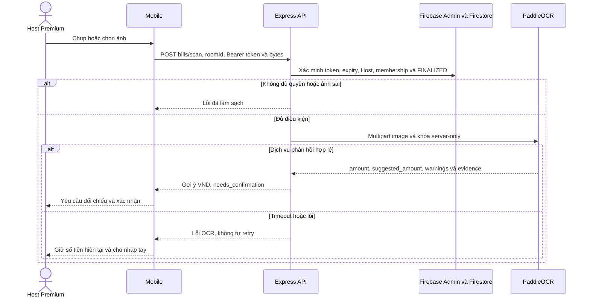

# SEQ-11 — PaddleOCR qua Express trong production

Development gọi trực tiếp PaddleOCR qua LAN được mô tả ở sơ đồ triển khai riêng. OCR không tự điền hay công bố bill.

Nguồn đối chiếu: [api-contracts.md](../../api-contracts.md).
