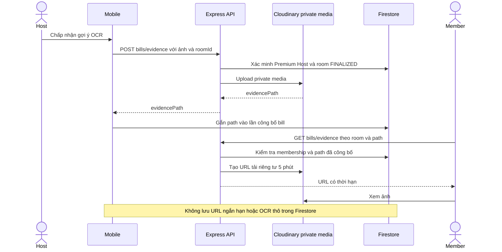

# SEQ-12 — Ảnh hóa đơn riêng tư

Tài nguyên chưa công bố có thể được Host yêu cầu xóa qua API; tài nguyên đã liên kết bill không được xóa bằng luồng này.

Nguồn đối chiếu: [api-contracts.md](../../api-contracts.md).
