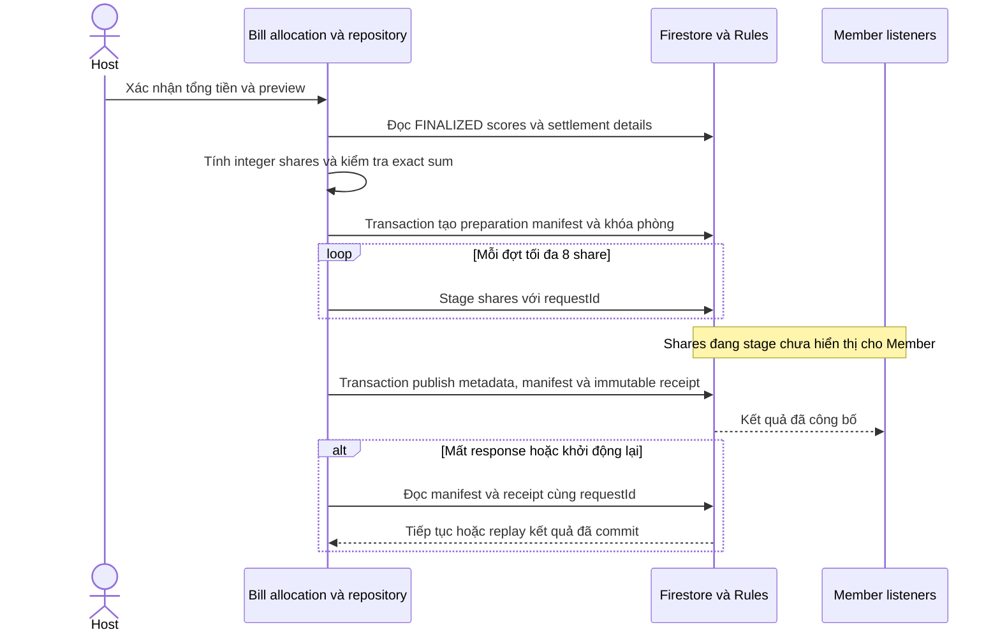

# SEQ-13 — Công bố phần chia theo từng đợt

Rules xác minh quyền, trạng thái và cấu trúc; không xác minh toàn bộ phép chia hay tính đầy đủ roster.

Nguồn đối chiếu: [decisions/ADR-021-spark-default-bill.md](../../decisions/ADR-021-spark-default-bill.md), [api-contracts.md](../../api-contracts.md).
