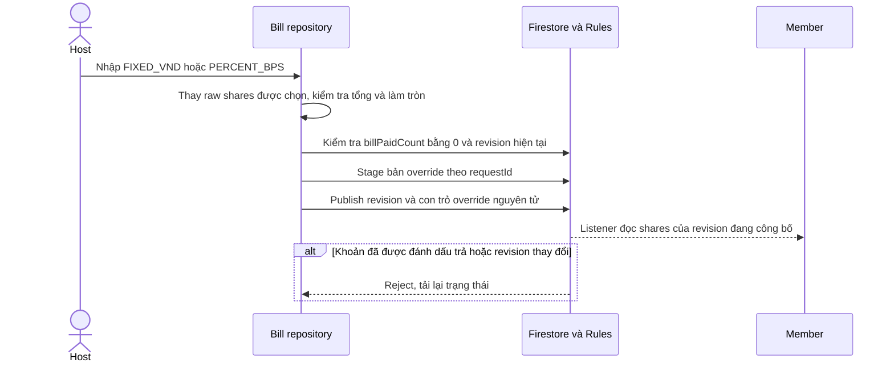

# SEQ-14 — Điều chỉnh phiên bản phần chia

Share ở bản cũ không được dùng để tạo QR hoặc xác nhận trả cho phiên bản mới.

Nguồn đối chiếu: [decisions/ADR-022-spark-bill-overrides.md](../../decisions/ADR-022-spark-bill-overrides.md), [api-contracts.md](../../api-contracts.md).
