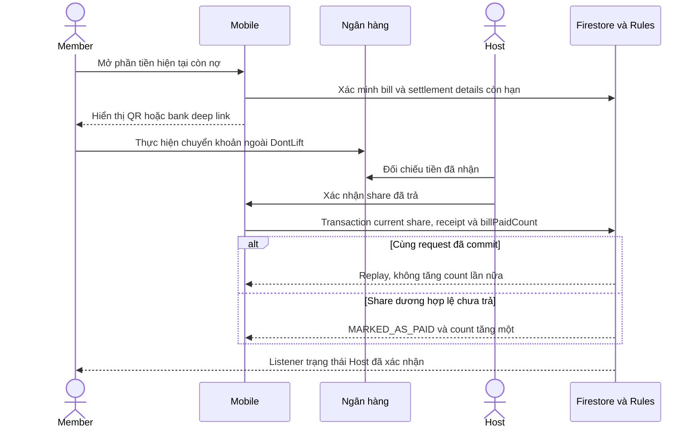

# SEQ-15 — Xác nhận trả tiền thủ công

Không có callback ngân hàng tự động. Share bằng 0 hiển thị không cần thanh toán.

Nguồn đối chiếu: [decisions/ADR-023-spark-manual-payment-status.md](../../decisions/ADR-023-spark-manual-payment-status.md), [api-contracts.md](../../api-contracts.md).
