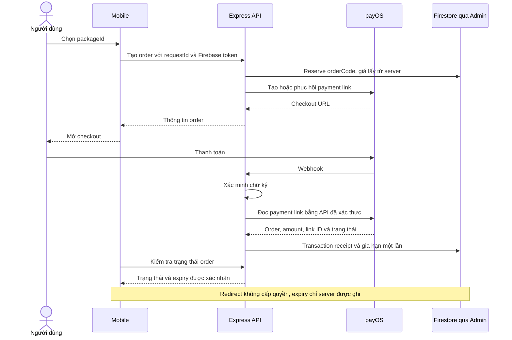

# SEQ-16 — payOS và cấp quyền có thời hạn

Đơn khác nhau cộng nối thời hạn từ max(now, expiry cũ); webhook lặp không cộng lặp.

Nguồn đối chiếu: [decisions/ADR-025-payos-expiring-premium.md](../../decisions/ADR-025-payos-expiring-premium.md), [api-contracts.md](../../api-contracts.md).
