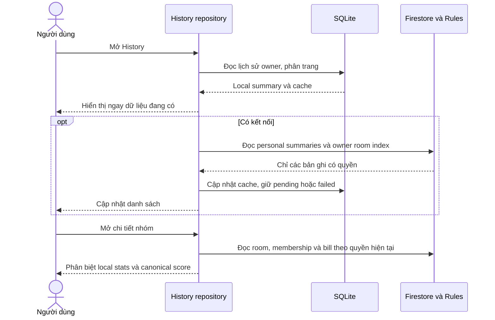

# SEQ-17 — Khôi phục lịch sử trên thiết bị

Thông tin chuyển khoản cần đọc mới trước khi mở VietQR; không khôi phục QR từ lịch sử cục bộ.

Nguồn đối chiếu: [decisions/ADR-030-solo-direct-summary-sync.md](../../decisions/ADR-030-solo-direct-summary-sync.md), [decisions/ADR-024-spark-group-history.md](../../decisions/ADR-024-spark-group-history.md), [decisions/ADR-028-shared-group-history-index.md](../../decisions/ADR-028-shared-group-history-index.md).
