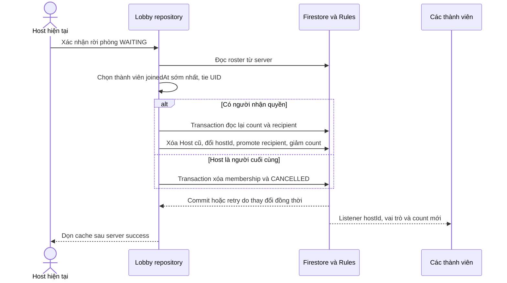

# SEQ-18 — Chuyển Host khi rời phòng chờ

Rules kiểm tra recipient đủ điều kiện và writes liên kết, không chứng minh thứ tự lựa chọn.

Nguồn đối chiếu: [decisions/ADR-026-spark-lobby-leave-host-transfer.md](../../decisions/ADR-026-spark-lobby-leave-host-transfer.md).
