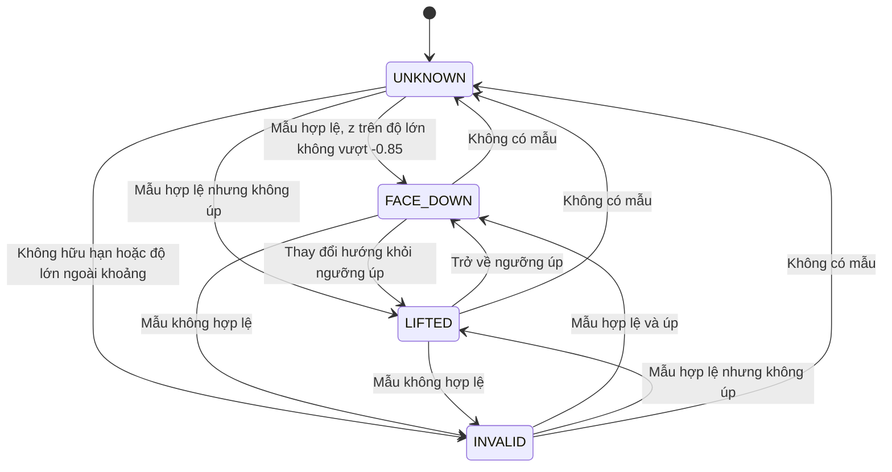

# STM-01 — Phân loại hướng điện thoại

Theo phone-down-engine.ts: độ lớn hợp lệ 0.65–1.35 g, z/magnitude ≤ -0.85 là FACE_DOWN. Không tự coi UNKNOWN là vi phạm.

Nguồn đối chiếu: [feature-specification.md](../../feature-specification.md).
